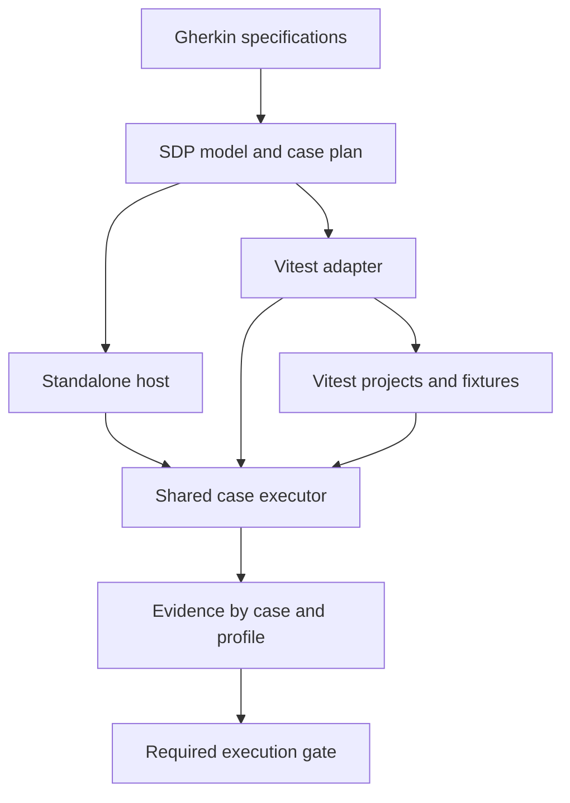

Please take a look at the discussion, the previous version of the SDP report that I'm referencing in the discussion, and possibly also check the two research reports that I listed here. I need help with suggestions on how to answer the questions from the discussion and basically make the correct decision.

/Users/darkomijic/work/sdp-new/docs/research/gherkin-forks.md

/Users/darkomijic/work/sdp-new/docs/research/research-organizing-specs.md

~~/Users/darkomijic/work/sdp-new/tmp-discussion.md~~

/Users/darkomijic/work/software-delivery-protocol/

06:55

I recommend three calls: adopt the backlog folder with one precise rule, make Vitest the place application suites run (sdp's own runner stays for the graph), and convert `libar-platform`'s tests to Gherkin area by area. Nothing changed in any repository; the three worked examples are in my scratchpad and all ran.

## 1. Backlog: one folder per area, defined by one tag

**The rule:** a feature whose `Feature:` line declares `@maturity=` sits in `<area>/backlog/`; every other feature sits directly in its area. Epic folders go inside `backlog/`.

```
specs/features/verify/
  check-specs.feature  run-specs.feature  …        ← tests: must pass, held to the git base
  backlog/
    run-specs-in-another-runner.feature
specs/features/adopt/
  backlog/sdp-in-every-agent-harness/              ← epic beside its work, inside the backlog
```

- **It is simpler than the earlier proposal.** That one had two kinds of subfolder (epic folders and `to-come/`) and the predicate "at least one live rule". This one has a single folder name and a predicate sdp already answers.
- **It ran.** I applied it to a copy of this repository: 13 features moved, `sdp check` reported 0 errors against the git base, and both guard queries returned nothing. The copy is in [backlog-layout](/private/tmp/claude-502/-Users-darkomijic-work-sdp-new/498262c5-e861-446a-8b09-af51edd418dd/scratchpad/backlog-layout).
- **Adopters need no step code.** The guard is two lines of sdp's built-in steps in their own GUIDE:

```gherkin
Then the query "feature[maturity][file!~/backlog/]" returns no results
And the query "feature[!maturity][file~/backlog/]" returns no results
```

- **A feature leaves the backlog once.** "Nothing live goes back" already makes that move one-way, so the research report's objection to `planned/` and `implemented/` trees (files shuttling, links breaking) doesn't apply.
- **A feature leaves its epic folder when it goes live**, even if the epic has other work left. The epic still names it with `@includes:`.

Three texts change with it:

- **The decision `still-to-come-is-marked-where-it-is-written`** says "Not a folder for work still to come beside one for built work", so it must be rewritten.
- **The decision `areas-for-reading-epics-for-work`** moves the epic folder under `backlog/`.
- **The skill** currently says "No folder says a maturity".

**Rules still to come inside live features** stay where they are: 22 rules in 6 features, plus 5 in ARCHITECTURE and GUIDE. They need no new command. `sdp q 'feature[!maturity] <-rule-of- rule[maturity]'` lists them today. The real gap is that `sdp lifecycle` prints all 36 unplanned items as one unreadable line; I'd make that section the backlog view, grouped by area and spec.

`★ Insight ─────────────────────────────────────`

- The folder adds no new state. It repeats one tag on a file's first line, and a scenario keeps the two in step, so it can't drift the way a hand-kept status does.
- "Backlog" then has one meaning: all work still to come. A whole feature in it gets the folder; a rule in it stays in its live file and shows in the view.
  `─────────────────────────────────────────────────`

## 2. Runner: sdp's own runner cannot load `libar-platform`

The earlier report called the Vitest adapter "the stronger case". It is the only case, for two reasons:

- **Imports.** I ran a step definition importing the platform's kernel through `sdp run`. It fails with `Cannot find module …/kernel/decider.js`: all 161 relative imports there use `.js` specifiers for `.ts` sources. See [runner-probe](/private/tmp/claude-502/-Users-darkomijic-work-sdp-new/498262c5-e861-446a-8b09-af51edd418dd/scratchpad/runner-probe). A resolver rule could fix this part.
- **The simulator tier.** It is built on `convex-test`, `import.meta.glob` and the edge-runtime environment, which only Vite provides. No resolver rule fixes that.

The adapter path works with real platform code. In [platform-in-vitest](/private/tmp/claude-502/-Users-darkomijic-work-sdp-new/498262c5-e861-446a-8b09-af51edd418dd/scratchpad/platform-in-vitest), one `.feature` file runs under the platform's Vitest 5.0.3:

| Scenario | Tier | Result |
| --- | --- | --- |
| Fold three events (real kernel `fold`) | `@pure` | passed |
| Sweep three expired receipts (real `receipts.sweep` on `convex-test`) | `@simulator` | passed |
| Sweep 1,001 receipts, bound of 1,000 | `@simulator` | passed |
| A daily schedule (rule at `@maturity=idea`) | `@simulator` | undefined step, run not failed |

A 9-line reporter wrote one sdp result per scenario with its id, tier and status. The run exits 0.

**My recommendation: sdp is not a test framework.**

- **`sdp run` stays** for what needs only the graph: GUIDE rules, gates, small workspaces, zero install.
- **Application suites run in Vitest** through an adapter that shares sdp's step matching and writes sdp's evidence.
- **Don't raise suite setup, scenario isolation or hard timeouts** in sdp's runner. This is where I differ from the earlier report. Six of the 22 rules still to come in live features are things Vitest already has; building them is rebuilding Vitest.
- **Vitest before Cucumber-JS.** The first adopter runs Vitest, and Cucumber-JS cannot run work still to come without failing the run.

What the adapter spec must settle before any code:

1. **One scenario, several tiers.** My results carry a tier; sdp's model has one result per scenario. I'd say a scenario is verified only when it passed in every tier its tags name. This is your call, and an `@open` rule on `run-specs-in-another-runner`.
2. **Filtering.** The prototype skips a scenario outside its tier, so 5 of 8 tests show as skipped. A real adapter leaves them out at collection.
3. **Staleness.** The fingerprint of what a scenario ran against must come from Vitest's module graph.
4. **Partial runs.** A run of one tier merges into the stored results instead of replacing them.

## 3. All tests to Gherkin: yes, per area

The platform has 169 test files: 106 native, 41 pure, 21 simulator, 1 hosted. I agree with the direction and with the earlier exception test: a test stays a unit test when no rule a developer could observe names what it checks.

- **Convert alongside the spec migration.** Each rule needs an example anyway, and an existing test is where it comes from. Delete the old test once its scenario passes in the same tier, so coverage never dips.
- **Tiers collapse.** A test duplicated across simulator and native becomes one scenario with two tags.
- **`test.each` becomes a Scenario Outline**, as the sweep bound did above.
- **Repository rules** such as `harness-rules`, `pinned-pairs` and `byfile-coverage` are GUIDE scenarios, not features.

## 4. The smaller questions

| Question | Recommended answer |
| --- | --- |
| Specs beside source files | No. Features cross modules here and in the platform, whose tests are grouped by tier, not module. |
| Areas by activity or by layer | By activity. Layers are an element attribute, and this ran: `element[layer=1] -imports-> element[layer>1]` found the planted violation. |
| `fact` as a kind | The team's word. sdp's vocabulary is free, so nothing is built. |
| JUnit report | Free from Vitest on the adapter path. Not worth specifying for `sdp run` until this repository has CI. |
| Option C, a dialect | No. A + B is built, and the three ideas stay in `write-specs-in-a-richer-grammar`. |
| `docs/research/` and `tmp-discussion.md` | Move to an archive branch, as `archive/redesign-2026-11` did, once the calls above are specs. Until then they fail the GUIDE's Markdown scenario. |
| The plugin specs with no iteration | A new iteration; neither existing one fits. |

`★ Insight ─────────────────────────────────────`

- The research on Gherkin forks names four kinds of compatibility: syntax, binding, execution, evidence. sdp must own binding and evidence, which is the shared core; execution is the part worth delegating.
- The adapter is small because Vitest calls `test()` at collection time, so a feature file compiles to a dozen lines. The work is in the evidence, not the compiling.
  `─────────────────────────────────────────────────`

## Calls that are yours

1. **Backlog per area** (`<area>/backlog/`), or one tree (`specs/backlog/<area>/`)? I recommend per area: CODEOWNERS and the reader stay in one folder.
2. **Convention or check?** I recommend the two GUIDE lines now, with sdp reading no meaning into the folder. The cost is that `sdp new` needs `--dir` to file an idea there.
3. **The runner decision**, which is decision-sized: sdp's runner for the graph, Vitest for application suites.
4. **The tier question** in point 1 of the adapter list.

One caution: several rounds of work on `organize-specs` are uncommitted, roughly 80 files. I'd commit that before the backlog move goes on top, so the review can read them apart.

1 changed file
07:01

Thank you. This is very solid. Let's also review the recommendation from Astra Pro but this is from the ChatGPT web interface so they didn't have access to local uncommitted and unpushed changes. Additionally we need to carefully decide what needs to be recorded as decisions or something along those lines because agents.md is growing. That is something that should be eliminated mostly. Also we have touched upon taxonomy and I have shared taxonomy from one of the very old projects. This is something that will be fixed and I will keep a keen eye on it. I don't want to finalize and fix it just yet but I will intervene if something gets added and so on without being discussed first.

````markdown
**I recommend proceeding with functional areas, an explicit backlog, concise Gherkin specifications, and a Vitest adapter for the first adopter. The most important prerequisite is strengthening the execution and evidence model so that SDP can reliably say what has actually been verified.**

The discussion contains several sound proposals, particularly keeping the official Gherkin parser and sharing execution semantics between hosts. It also closes some product decisions too quickly. I would reopen the decisions about research documents, temporary epic directories, deriving all classification from existing code, and treating a published Obsidian vault as a complete replacement for browser exploration.

## What I checked

I read the discussion and both research reports, inspected both linked repositories, and also inspected `libar-platform` because it became the concrete adoption case in the discussion.

| Repository | Inspected state | Relevant qualification |
|---|---|---|
| `sdp-new` | [Main at `aa5e187`](https://github.com/libar-dev/sdp-new/tree/aa5e187ea0bf1b100e80fbc2fc96b879707e3241) | The `organize-specs` branch described in the discussion is not published. Its reported changes and successful runs remain claims from the transcript. |
| `software-delivery-protocol` | [Main at `f990bde`](https://github.com/libar-dev/software-delivery-protocol/tree/f990bded1d7ca86f19f5746ef412613f8e908be3), plus the [PR #43 plugin implementation](https://github.com/libar-dev/software-delivery-protocol/tree/605a19b8f8c61d250ee7526d55e8d88a3111435e) | The plugin implementation is not represented by inspecting main alone. |
| `libar-platform` | [Main at `ce21b97`](https://github.com/libar-dev/libar-platform/tree/ce21b97eb00aefe8be527d67a90e0178aa1b50c3) | Its published snapshot differs from the local snapshot described in the conversation. |

I installed the locked dependencies in the review checkout and ran SDP’s status, query, and check commands. **The published `sdp check` currently fails because configuration still names `origin/review/redesign` as its comparison base.** This corroborates the stale-base issue identified in the conversation; I did not independently reproduce the unpublished branch’s reported 475-scenario verification. The stale setting is visible in [the published configuration](https://github.com/libar-dev/sdp-new/blob/aa5e187ea0bf1b100e80fbc2fc96b879707e3241/sdp.config.yaml).

---

# 1. The decisions I would make now

Here is my recommended disposition of the major choices, followed by the reasoning and implementation consequences.

| Decision | My recommendation |
|---|---|
| Functional organization | Adopt the six functional areas now. Multiple bounded contexts are not a prerequisite for useful navigation. |
| Backlog | Provide a complete backlog view, plus `<area>/backlog/` for wholly prospective feature files in these repositories. |
| Mixed features | Keep future rules beside the existing rules they extend. Include them in the backlog view. |
| Epics | Small planning objects with outcome and inclusion links; give them a consistent home under `specs/plan/epics/`. |
| Colocation | Support central and package-local specifications. Allow source-adjacent contracts where there is a clear ownership boundary. |
| Layers | Metadata, with a distinction between intended classification and classification of existing implementation elements. |
| Parser | Official Gherkin plus targeted diagnostics. Retain richer-language alternatives as ideas with explicit reconsideration triggers. |
| Tests | Gherkin as the authored specification for behavioral contracts, running inside Vitest for `libar-platform`. |
| Runner architecture | Shared case execution semantics and evidence, with Vitest and the existing standalone runner as hosts. |
| Verification | Introduce profile-aware evidence and an explicit inventory of required executions before scaling migration. |
| Agent integration | One canonical package and skill source, with tested wiring for each harness. |
| Human interfaces | Obsidian vault first; retain the browser-reader requirement until a publishing route satisfies it. |
| Supporting research | Keep useful research outside the normative specification graph. Replace the Markdown allowlist restriction. |

These are recommendations for your decision. They should not all become universal restrictions imposed on every SDP adopter.

# 2. Define “future,” “live,” and “verified” precisely

This distinction affects almost every other decision.

The existing design already separates declared maturity from derived stage. Preserve that direction, but sharpen the meaning of **live**. The current [maturity decision](https://github.com/libar-dev/sdp-new/blob/aa5e187ea0bf1b100e80fbc2fc96b879707e3241/specs/decisions/declared-maturity-derived-stage.feature) supports deriving verification from execution rather than writing it manually.

I recommend these meanings:

| Concept | What it means |
|---|---|
| **Maturity** | How refined a prospective contract is: idea, draft, specified, ready. |
| **Live contract** | Behavior the project currently commits to satisfying and enforcing. |
| **Execution result** | What happened when a particular case ran against particular inputs and an execution environment. |
| **Verified** | Admissible current evidence satisfies the required cases and execution profiles. |
| **Planning** | Which changes the project intends to deliver, in what sequence. |

A live contract can be broken or unverified. A future rule can already pass experimentally. Neither condition should automatically change its contractual status.

This also resolves several organizational questions:

- A failing live feature stays in its normal area.
- An experimental passing feature can remain in the backlog.
- An epic is not complete merely because its children have lost their maturity tags.
- A passing simulator execution does not establish native-backend behavior.
- A previous pass cannot automatically satisfy a CI run that failed to collect a required test.

**Keep the existing “absence of maturity means live” convention if you like it. Avoid making “live” also mean “implemented, tested, and currently correct.”**

You also need a deliberate retirement policy eventually. “Nothing live goes back” is a useful default guard, but real products sometimes remove an obsolete contract. Approved removal, replacement, and breaking change need an explicit path; they should not require inventing a fictional replacement merely to satisfy the checker.

# 3. Organization: stable areas, visible backlog, lightweight epics

## Functional areas are justified now

I disagree with the initial recommendation to remain flat until a second bounded context appears.

A bounded context defines a model and language boundary. A functional area helps a person navigate. Those serve different purposes. Your preference for meaningful navigation is sufficient reason to introduce areas.

For `sdp-new`, the proposed areas are reasonable:

| Area | Reader’s question |
|---|---|
| `adopt` | How do I install and introduce SDP? |
| `specify` | How do I express requirements, decisions, and relationships? |
| `verify` | How do I execute and trust those specifications? |
| `architect` | How do I describe and inspect the architecture? |
| `deliver` | How do I plan, review, and release changes? |
| `explore` | How do humans and agents interrogate the state? |

Cucumber’s own organization guidance supports navigation by functional area and capability, and warns against making temporary delivery stories the permanent organization of behavioral documentation. It does not require every useful directory to represent a bounded context. [Cucumber](https://cucumber.io/blog/bdd/solving-how-to-organise-feature-files/?utm_source=chatgpt.com)

For larger adopters, allow additional capability nesting where it improves navigation. **Do not turn “one directory level only” into a universal SDP invariant.**

## Make the backlog complete, even when its physical folder cannot be

You explicitly chose the term **backlog**. I would implement it in two complementary ways.

**Physical organization:** a feature whose rules are all prospective lives under `<area>/backlog/`. When its first rule becomes an active contract, move the whole feature into its stable area or capability directory.

**Authoritative backlog view:** include every prospective feature, prospective rule inside an active feature, and unresolved decision that blocks prospective work.

The view is essential. A folder containing only wholly prospective features cannot represent the future rules inside mixed features.

For example:

```gherkin
@id=run-a-business-intent-once
Feature: Run a business intent once

  Rule: Repeating a completed request returns its stored outcome

    Scenario: Retry a completed request
      Given a request has completed
      When the same request is submitted again
      Then its stored outcome is returned

  @maturity=idea
  Rule: Expired receipts are removed by scheduled maintenance
```

The feature remains in its normal home. The maintenance rule appears in the backlog.

I would make folder consistency a **GUIDE convention for your repositories**, with metadata authoritative. SDP itself should support workspaces that use a stable tree and a generated backlog without physical backlog directories.

There is a cost to the one promotion move. IDs can protect internal graph links, while GitHub links, ownership patterns, discovery configuration, and human bookmarks may still need attention. “Cheap internal move” is more accurate than “free move.”

## Give epics one consistent home

My preference is:

| Content | Suggested home |
|---|---|
| Active and mixed features | `specs/features/<area>/…` |
| Wholly prospective features | `specs/features/<area>/backlog/…` |
| Epics | `specs/plan/epics/…` |
| Iterations and milestones | `specs/plan/…` |
| Decisions | `specs/decisions/…` |
| Platform assumptions and probes | `specs/platform/…`, where useful |
| Shared step libraries | Grouped by domain subject or explicit binding scope |

An epic needs an outcome and links to the features or rules contributing to it. It does not need copied requirements, copied status, or a separate essay.

I would avoid the proposed pattern in which features live inside a temporary epic directory and move again when the epic is deleted. An area view can show a local epic beside its work without making the planning object own the features’ filesystem locations.

There is a concrete implementation detail here: **the published default vocabulary includes `epic` in the requirements discipline.** Treating epics as planning containers therefore requires an explicit vocabulary/policy change, not just adding files with `@kind=epic`. See [the default disciplines](https://github.com/libar-dev/sdp-new/blob/aa5e187ea0bf1b100e80fbc2fc96b879707e3241/src/model/Vocabulary.ts#L93-L106).

For completion, require the epic’s intended scope and evidence to be satisfied. Then remove or archive it according to the repository’s retention policy, checking incoming references. I would not make automatic deletion on “all included work is live” the default.

## Allow colocation where ownership is clear

I would support three arrangements:

| Scope | Preferred placement |
|---|---|
| Behavior spanning several modules | Central functional-area specifications |
| Capability owned by one package or service | That package’s `specs/` directory |
| Small architectural or module contract | Source-adjacent placement can be appropriate |

A feature touching several modules does not necessarily prevent package-level colocation. The relevant question is whether there is one coherent ownership boundary, not whether only one source file implements it.

For both current repositories, central feature trees look sensible. For SDP as a product, discovery should accommodate multiple roots within one graph. Execution reliability and CI inclusion must remain independent of placement.

## Use metadata for layers, including future architecture

Your conclusion about layers is right. I would qualify the subsequent proposal that layer classification must always originate in existing code.

Existing code can declare the layer of an implemented architectural element. Prospective capabilities also need classification before that code exists. Otherwise the backlog cannot be organized by intended layer.

Use metadata to distinguish:

- the intended scope of a feature or proposed capability;
- the actual layer of each implementation element;
- consistency constraints between them.

A feature spanning several layers should not be forced into a single layer value. The import rule—such as a lower layer importing no higher layer—belongs in an architectural specification and should be checked against the code graph.

Start `fact` or `assumption` as an adopter vocabulary choice. A platform probe should identify the dependency version and environment it observes. Being outside planning disciplines must not exempt it from required execution.

## Split large features by meaning

`plan-delivery` is a candidate for separating planning work from evaluating or recording milestones, if those are independently useful reader questions.

Rule count alone is insufficient. Large inline fixtures can make a coherent feature long; a short feature can still mix unrelated responsibilities.

Also, whole-file identity and rule identity behave differently. Current rule IDs incorporate the feature ID and slugged rule title; scenario IDs can receive collision suffixes. Splitting or renaming therefore requires intentional link migration and refreshed evidence. See [identity construction](https://github.com/libar-dev/sdp-new/blob/aa5e187ea0bf1b100e80fbc2fc96b879707e3241/src/parse/Gherkin.ts#L392-L437).

# 4. The Vitest adapter: adopt it first, with a narrow shared core

**A Vitest adapter is fully compatible with your intention to refactor the tests into actual Gherkin.**

The `.feature` files become the authored behavioral tests. Step definitions implement their vocabulary using your existing harness. Vitest supplies collection, projects, execution environments, setup, workers, reporting, and developer tooling.

The important mapping is:

| Authored construct | Execution representation |
|---|---|
| Feature | Test-module grouping |
| Rule | Suite or reporting grouping |
| Scenario | One test case |
| Scenario Outline row | One separately identifiable test case |
| Step | An operation inside that case |

Keep the scenario as the unit of execution, retry, state, and evidence.

## Recommended boundary



The **shared executor** owns binding, parameter conversion, step ordering, scenario worlds, semantic outcomes, cancellation cooperation, and scenario cleanup.

**Vitest owns** scheduling, its project environments, worker configuration, suite setup, watch mode, coverage, and host lifecycle.

Do not put the complete existing `runWorkspace()` pipeline inside every Vitest test. It performs workspace loading, selection, result persistence, and gates; doing that per test would nest execution orchestration and repeat expensive work. Extract a smaller “execute this compiled case with these bindings and resources” API. The current responsibilities are visible in [Running.ts](https://github.com/libar-dev/sdp-new/blob/aa5e187ea0bf1b100e80fbc2fc96b879707e3241/src/app/Running.ts).

## Keep the native runner for now

Retaining it initially avoids making its replacement a prerequisite for adoption. It already serves SDP’s own specifications.

However, constrain its scope. There is little value in independently rebuilding Vitest’s entire fixture, worker, mocking, coverage, and watch ecosystem. Reassess the standalone host after the adapter demonstrates whether it has continuing independent value.

The native route is also feasible through an external setup wrapper or additional lifecycle support. The reason to prefer Vitest for `libar-platform` is the existing harness and integration investment. Its [current configuration](https://github.com/libar-dev/libar-platform/blob/ce21b97eb00aefe8be527d67a90e0178aa1b50c3/vitest.config.ts) already defines separate projects and native backend setup.

## Isolation and timeouts need explicit contracts

The discussion overstates what Vitest provides automatically.

Vitest isolates test files according to its configured execution model. Tests inside a file still share that file’s execution environment; concurrent tests do not acquire separate workers. External database state requires its own isolation. [Vitest](https://vitest.dev/guide/parallelism.html?utm_source=chatgpt.com)

Therefore specify:

- a fresh world for each scenario or outline row;
- owned data, tenant identifiers, temporary files, and resources;
- cleanup after failure and cancellation;
- which shared resources are permitted;
- the actual scope of serialization.

In particular, SDP’s current `@serial` means cases run alone after the selected parallel cases. Mapping it to `describe.sequential` would not automatically preserve that guarantee across other files and projects. [The current scheduling code makes this distinction visible.](https://github.com/libar-dev/sdp-new/blob/aa5e187ea0bf1b100e80fbc2fc96b879707e3241/src/run/Runner.ts#L209-L229)

Likewise, an `AbortSignal` supports cooperative cancellation. It cannot interrupt an infinite synchronous loop on the same event loop. A hard-stop guarantee requires supervision from another worker or process. Vitest provides a cancellation signal that resource handlers must use; this is not automatic cleanup of every resource. [Vitest](https://vitest.dev/guide/recipes/cancellable?utm_source=chatgpt.com)

I would prioritize scenario cleanup and backend isolation now. Specify hard termination only to the strength you actually implement.

# 5. Strengthen evidence before migrating broadly

This is the most consequential code-level finding.

## Results currently collide across profiles

In the published implementation, results are stored by **scenario ID**. The merge operation replaces the stored result for that ID. The schema has fingerprints, but no independent execution-profile, target, run, or attempt identity. See [the results schema](https://github.com/libar-dev/sdp-new/blob/aa5e187ea0bf1b100e80fbc2fc96b879707e3241/src/model/Results.ts#L62-L85) and [store merge](https://github.com/libar-dev/sdp-new/blob/aa5e187ea0bf1b100e80fbc2fc96b879707e3241/src/run/Store.ts#L73-L86).

**If the same scenario runs in simulator and native projects, those results would collide. A passing simulator result could replace the native failure in the persisted SDP view.**

The native run’s own exit code can still fail correctly. The risk concerns what the graph subsequently claims.

Before supporting multiple projects, distinguish:

| Identity | Purpose |
|---|---|
| Specification | The authored rule and scenario |
| Concrete case | The scenario or particular outline row |
| Execution profile | The selected project and binding configuration |
| Target | For example, a local pinned backend or hosted deployment |
| Run and attempt | Invocation, retries, and repetitions |
| Inputs | Relevant source, steps, configuration, fixtures, dependencies, and environment |

The platform already records project, target, versions, clean/dirty state, and unhandled errors. Preserve those strengths during migration. [Its existing reporter is a useful reference.](https://github.com/libar-dev/libar-platform/blob/ce21b97eb00aefe8be527d67a90e0178aa1b50c3/harness/evidence.ts#L30-L90)

## A CI gate must know what was required to run

A successful selected subset does not establish complete verification.

Define the required case/profile combinations for each gate, then compare them with what was collected and completed. Required cases that were filtered away, skipped, never collected, aborted, or left without a final result must prevent that gate from passing.

Evidence reuse should be an explicit policy. Matching fingerprints and trusted provenance may justify reuse; retaining yesterday’s results file should not silently do so.

There is a related issue with the proposed `fact` kind: the current GUIDE verification gate queries features and their live rules. Required platform probes and other kinds need to be included explicitly. [The existing gate is here.](https://github.com/libar-dev/sdp-new/blob/aa5e187ea0bf1b100e80fbc2fc96b879707e3241/specs/GUIDE.feature#L227-L237)

## Preserve actual outcomes for prospective work

It is reasonable for exploratory future scenarios to be non-gating. Still record their actual attempted outcome.

A prospective scenario that executed and failed should retain:

- the failure;
- its reason;
- its execution profile;
- the fact that it did not block that run.

A standard reporter may need a simplified representation, but SDP’s evidence should not erase the distinction between an unsuccessful experiment and a test that never ran.

## Finalize evidence after mandatory cleanup

The platform already handles a subtle case: its final backend cleanup can mark the run record failed after the reporter wrote it. An adapter must preserve that behavior. [See `finalSweep`.](https://github.com/libar-dev/libar-platform/blob/ce21b97eb00aefe8be527d67a90e0178aa1b50c3/harness/native-run.ts#L85-L101)

Similarly:

- retries must retain earlier failed attempts;
- relevant changes during execution must invalidate the result;
- transformed or mocked Vite inputs need host-aware fingerprinting;
- commit SHA alone is insufficient for dirty working trees.

A conservative fingerprint of all configured relevant inputs is a better first implementation than an unproven claim of perfectly precise dependency tracking.

# 6. How I would handle the mixed specifications

The following reflects the **local inventory reported in your discussion**, not a claim that those unpublished changes are on GitHub.

| Mixed specification | Recommended disposition |
|---|---|
| `ARCHITECTURE` | Implement the justified compiler/Effect diagnostics improvements as a small independent change. |
| `GUIDE` | Prioritize real CI and required verification; keep formatting and local hook conventions separate from product capabilities. |
| `plan-delivery` | Define epic semantics and the brief orientation projection. Defer Git activity presentation until it answers a demonstrated planning need. |
| `ask-the-graph` | Prioritize a versioned answer contract, snapshot identity, completeness, and the data consumers actually require. Measure scale separately. |
| `check-specs` | Preserve computed diagnostics. Resolve Markdown handling through explicit source scope and policy. |
| `know-what-is-verified` | Raise profile-aware evidence, required-execution completeness, and controlled evidence reuse to the front of the plan. |
| `run-specs` | Make Vitest integration concrete. Add Cucumber Messages after normalized execution events exist. |
| `write-step-definitions` | Prioritize resource lifecycle, isolation, deterministic bindings, and shared parameter registration. Keep keyword-sensitive matching a separate choice. |

There is no need to move these future rules into separate files merely to make a backlog folder look complete.

For phases and disciplines, retain optional support. Your default planning experience can remain a simple sequence of iterations and milestones. A richer lifecycle should be adopted where it changes decisions, rather than because an example happens to resemble a particular process framework.

# 7. Gherkin and extensions: adopt A+B, preserve the alternatives

**Official Gherkin plus a semantic layer and diagnostics remains the best current choice.**

Most needs in the discussion—metadata, scope, parameters, lifecycle, execution hosts, and evidence—do not require grammar changes.

However, compatibility needs four explicit dimensions:

1. Syntax.
2. Step binding.
3. Execution behavior.
4. Evidence and reporting.

Standard tools parsing a file does not mean they understand SDP’s maturity or gating semantics.

## Diagnostic policy

Use errors for violations of the declared SDP annotation contract and reliably detectable loss of graph-bearing information.

Use configurable warnings for authoring suspicions:

- possible prose interpreted as a step;
- a heading swallowed as a comment;
- an unexpectedly empty background.

A step ending in a full stop is not inherently wrong. The absence of false positives in SDP and the shop example is insufficient evidence for making that a universal rule.

The official language itself distinguishes features, rules, examples, and step execution, and its standard matching ignores the Given/When/Then keyword. Changing that matching behavior is therefore an execution compatibility decision. [Cucumber](https://cucumber.io/docs/gherkin/reference/?utm_source=chatgpt.com)

## Remaining extension decisions

| Extension | Recommendation |
|---|---|
| Scoped step libraries | Adopt explicit scopes when needed. Moving a feature between navigation folders should not unexpectedly change its bindings. |
| Keyword-sensitive matching | Preserve existing behavior initially; consider an explicit strict mode with defined `And`/`But` semantics. |
| Custom parameter types | Worth adding through one registry shared by discovery and execution. |
| Cucumber Messages | Useful export after the common case-event model exists. |
| Cucumber-JS plugin | Keep as a later adapter, driven by an adopter who already uses Cucumber-JS. |
| External or dynamic examples | Defer until needed; require deterministic expansion, case identity, and input fingerprints. |
| Property testing | Preserve generators and shrinking. A Gherkin rule can frame a property test without enumerating every generated case. |
| Step composition | Prefer typed helper composition behind steps initially. Executable feature-to-feature calls add lifecycle and control-flow semantics. |
| Localization | Add representative conformance cases if localized Gherkin is part of the support promise. |
| Custom dialect, grammar fork, new language | Keep as ideas, with concrete unmet requirements as reconsideration triggers. |

Multiple ideas can live in one coherent prospective feature. Independently useful capabilities can have small idea-level features. Mutually exclusive solutions should remain identifiable as alternatives to one decision, so they do not all appear as committed delivery scope.

# 8. Gherkin-first migration, with narrow exceptions

I support your preference to make behavioral contracts actual Gherkin tests.

For a platform library, the domain language can appropriately be technical: commands, receipts, journals, tenants, generations, transactions, and outcomes. Readability does not require pretending these are end-user UI stories.

I would use the following policy:

| Test category | Recommended treatment |
|---|---|
| Command behavior, receipts, tenancy, rollback, read models | Gherkin rules and scenarios over the existing harness |
| Pure deciders | Gherkin is a strong fit |
| Platform assumptions | Executable probes with dependency/environment qualification |
| Public type contracts | Gherkin where a clear requirement benefits from an example; retain direct type assertions where they are the precise proof |
| Small implementation helpers | Allow conventional tests when a Gherkin formulation adds little explanatory value |
| Property, fuzz, and specialized concurrency checks | Keep their specialized machinery; connect them to a meaningful contract where useful |
| Performance requirements | Measured examples with explicit workloads and environments |

The exception criterion should be whether the alternative test form provides clearer or stronger evidence. “It is a pure function” is not sufficient reason to exempt it from Gherkin; “a developer can name its behavior” is not sufficient reason to force it into Gherkin either.

## Migration should preserve obligations

For the first slice, use idempotency and receipts. It exercises meaningful behavior, failures, concurrency, and multiple execution environments.

For each slice:

1. Inventory the existing assertions, race conditions, failure injections, and required profiles.
2. Map old specification IDs and tests to new rules and cases.
3. Write readable scenarios.
4. Bind them to existing harness operations.
5. Run both forms during the transition.
6. Introduce representative faults and confirm that the new scenarios detect them.
7. Check evidence and CI completeness.
8. Remove the superseded specifications and tests.

Do not use a line-reduction ratio as the acceptance criterion. The reported 356-to-64-line conversion is encouraging, but it does not establish equivalent coverage or justify extrapolating the same compression across the corpus.

During coexistence, give the two SDP generations explicit command entrypoints and configurations. The platform currently depends on the old package through a pinned GitHub revision, so “both tools use different globs” alone does not resolve package and `sdp` executable ambiguity. [The current dependency is visible in `package.json`.](https://github.com/libar-dev/libar-platform/blob/ce21b97eb00aefe8be527d67a90e0178aa1b50c3/package.json)

# 9. Recommendations for the other workstreams

## Effect 4

Keep the existing architectural boundary: pure parsing, graph, query, and checking functions; Effect for I/O, resources, typed failures, cancellation, and orchestration.

The repository already follows that direction substantially. It has an explicit [Effect decision](https://github.com/libar-dev/sdp-new/blob/aa5e187ea0bf1b100e80fbc2fc96b879707e3241/specs/decisions/effect-for-io.feature), filesystem services, scoped operations, Effect-native entrypoints, and a Promise-facing API.

I would:

- enable `exactOptionalPropertyTypes`;
- add Effect-aware diagnostics with a tested failure fixture;
- verify interruption and release behavior through meaningful cases;
- upgrade compatible Effect packages together;
- test the public package against consumer configurations.

Current Effect documentation supports `@effect/tsgo` for the TypeScript 7 toolchain and describes diagnostics for unused Effect values. [effect.website](https://effect.website/docs/v4/getting-started/devtools?utm_source=chatgpt.com)

Adding `@effect/vitest` is optional. Its value is convenient runtime-aware testing, not evidence that the project otherwise uses Effect incorrectly. Conversely, having many scenarios does not itself establish that every resource-lifecycle risk is covered.

Keep a performance requirement even if the proposed 300 MB threshold and Git-I/O diagnosis were wrong. Define representative corpus sizes, warm and cold behavior, latency, peak memory, and a reference machine. The reported 1.1 GB measurement was not independently reproduced here.

## Agent plugin, skills, and hooks

Adopt one canonical package and skill source, with explicit per-harness integration.

The Agent Plugins standard’s portable core covers skills and MCP. Hooks remain client extensions with client-defined behavior. This makes a support matrix necessary. [Agent Plugins](https://agent-plugins.org/specification?utm_source=chatgpt.com)

My choices would be:

- One concise entry skill covering the ordinary workflow, with references loaded on demand.
- Separate job skills only where they improve discovery.
- One orientation implementation, reused by harness adapters.
- Workspace discovery following SDP configuration, rather than assuming the nearest `package.json` is the workspace.
- Invocation of the workspace’s pinned SDP version, with incompatibility reported.
- One hook registration per supported route, avoiding duplicate wiring.
- Tests proving that output reaches the **model’s context**, including the intended interactive and headless modes.

Keep a small bootstrap route for clients that cannot install the plugin. Once plugin delivery is proven, `sdp init` should stop maintaining a second complete copy of the skill.

Two previously open facts are now documented: the OpenAI plugin documentation describes loading an installed cache copy, and documents `PLUGIN_ROOT` plus `CLAUDE_PLUGIN_ROOT` compatibility variables. It also describes hook trust and distribution restrictions. Those facts reduce uncertainty, but do not replace testing the CLI and app-server configurations you actually use. [OpenAI Developers](https://developers.openai.com/plugins/build/plugins?utm_source=chatgpt.com)

Treat 2,000 characters and five seconds as provisional orientation budgets. Make truncation visible and keep the hook useful when a large workspace cannot produce the full answer within that budget.

## Graph API and recipes

Build on the existing shared application layer. It already exposes an answer envelope containing `complete`, `notes`, and `data`, and propagates bounded-query incompleteness. See [Answer.ts](https://github.com/libar-dev/sdp-new/blob/aa5e187ea0bf1b100e80fbc2fc96b879707e3241/src/app/Answer.ts) and [Reading.ts](https://github.com/libar-dev/sdp-new/blob/aa5e187ea0bf1b100e80fbc2fc96b879707e3241/src/app/Reading.ts).

Start with named recipes for orientation, feature context, change impact, backlog, blocking questions, and missing/stale/failing evidence.

Add:

- a versioned response schema;
- snapshot identity, including dirty inputs;
- source locations;
- selection and omission information;
- explicit unknown-subject errors;
- bounded output with continuation or a clear truncation result.

“Complete” should mean complete within declared source and query scope. An unreadable configured input is different from intentionally excluded research.

The old repository’s useful lesson is composing consumers over one graph snapshot. Its numbered recipes or arbitrary-JavaScript evaluation interface are not prerequisites for that benefit.

## Mermaid diagrams

Fix the existing exporter before building a large diagram catalog. The current implementation assigns positional aliases such as `n0` and only escapes quotation marks in labels. [That is directly visible in the exporter.](https://github.com/libar-dev/sdp-new/blob/aa5e187ea0bf1b100e80fbc2fc96b879707e3241/src/graph/Export.ts#L86-L104)

Require stable aliases, deterministic ordering, appropriate escaping, and explicit folding or omission.

Start with:

- feature/rule/evidence relationships;
- architectural dependencies;
- epic and backlog scope;
- milestone and iteration structure.

Keep a 60-node threshold as a configurable presentation budget. Generate only diagram types whose semantics the graph contains.

Writing standalone owned outputs is a good default. Freshness checks should apply to explicitly required materialized or published outputs. An absent ignored local diagram or vault should not break a clean checkout.

## Obsidian vault and browser Studio

Generate the vault and ignore its generated content in Git by default. Preserve stable links, avoid rewriting unchanged notes, and put human notes and customized settings outside the generator’s owned subtree.

The older implementation contains useful ownership protections worth retaining. [Its synchronization code](https://github.com/libar-dev/software-delivery-protocol/blob/f990bded1d7ca86f19f5746ef412613f8e908be3/src/projections/vault/sync.ts) distinguishes generated files from foreign or changed content.

**Retain the browser-reader requirement.** Select the vault as the first interface, then test whether a publisher supplies the required browser navigation, filtering, diagrams, evidence visibility, and sharing.

Obsidian Bases are their own YAML view format; publishing Markdown does not by itself establish support for those views. [obsidian.md](https://obsidian.md/help/bases/syntax?utm_source=chatgpt.com)

The old repository itself distinguishes the vault user from the reviewer holding a URL. That product distinction is sound and should survive the simplification. [See its vault specification.](https://github.com/libar-dev/software-delivery-protocol/blob/f990bded1d7ca86f19f5746ef412613f8e908be3/specs/consumers/obsidian-vault.sdp.md)

# 10. Research documents, CI, and packaging

## Replace the Markdown allowlist rule

Your objection concerns verbose normative specifications and unrelated documents polluting the graph. Useful supporting research can remain in the repository without becoming a contract.

I would distinguish:

| Material | Treatment |
|---|---|
| Required behavior | Gherkin rules and examples |
| Significant choice and rationale | Concise decision |
| Research and supporting evidence | Markdown or other source material, outside normative discovery |
| Generated views | Explicitly generated outputs |
| Obsolete status narratives | Remove when they no longer serve a purpose |

The current GUIDE scenario enumerates the permitted Markdown files exactly. That is why the discussion repeatedly moved research out of the checkout to obtain a passing run. [The restriction is here.](https://github.com/libar-dev/sdp-new/blob/aa5e187ea0bf1b100e80fbc2fc96b879707e3241/specs/GUIDE.feature#L199-L205)

Replace it with the useful invariant: **requirements must be represented in the normative corpus, and supporting documents must not silently become specifications.**

Verification should run against the intended real checkout.

## CI and local hooks

The repository’s own workflows and review policy belong in GUIDE and configuration. A reusable CI-scaffolding product would be a separate capability only if SDP promises it to adopters.

I recommend:

- fast local feedback at commit;
- broader verification before push where practical;
- required CI as the enforcement boundary;
- full required-execution accounting;
- a valid Git comparison base;
- testing the packed package in a clean consumer environment;
- release provenance and controlled publishing.

Cross-model review is a useful practice for your fleet. GitHub rulesets can enforce reviews and status checks, but model-family provenance needs a trusted custom check or attestation if you want to enforce it mechanically. [GitHub Docs](https://docs.github.com/en/repositories/configuring-branches-and-merges-in-your-repository/managing-rulesets/available-rules-for-rulesets?utm_source=chatgpt.com)

For the Vitest adopter, use Vitest’s JUnit reporter initially. Configure GitHub reporting separately: a JUnit file alone does not produce all the native GitHub UI described in the discussion. Vitest has a distinct GitHub Actions reporter, and an explicit reporter list replaces defaults. [Vitest](https://vitest.dev/guide/reporters?utm_source=chatgpt.com)

## Packaging

I would use **`@libar-dev/software-delivery-protocol`**, retaining `sdp` as the command, provided this is the intended successor to the old package. Confirm registry ownership before release.

Keep source execution convenient inside the repository, while testing the actual packed JavaScript and declaration files. The current installation specification already distinguishes those delivery forms. [See `install-from-npm`.](https://github.com/libar-dev/sdp-new/blob/aa5e187ea0bf1b100e80fbc2fc96b879707e3241/specs/features/install-from-npm.feature)

Initially support the Node version you already use and test. Expand support through a deliberate consumer matrix. Exact dependency pins aid repeatability, but exposed Effect types also require a compatibility policy.

# 11. What to record, and what to build next

## Record a small number of substantial decisions

I would create or update decisions covering:

1. **Contract state and verification:** maturity, active obligations, profile-specific evidence, and required-execution completeness.
2. **Execution architecture:** shared case semantics and evidence, with host-owned orchestration.
3. **Organization:** stable functional navigation, explicit backlog, and epics referencing durable behavior.
4. **Authoring compatibility:** official Gherkin plus SDP semantics and diagnostics.
5. **Derived consumers:** one graph snapshot serving agents, diagrams, vaults, and browser readers.

Keep exact directory names, local hooks, formatting conventions, and routine workflow configuration in GUIDE. Put observable product behavior in feature rules. Keep meaningful alternatives as ideas until a concrete requirement justifies reconsidering them.

## Deliver in this order

| Stage | Concrete outcome |
|---|---|
| **1. Policy and organization** | Agree the semantics above; establish areas, backlog, epic conventions, and supporting-document policy. |
| **2. Execution and evidence contract** | Specify case identity, profiles, required executions, lifecycle, retries, cancellation, and finalization. |
| **3. First adopter slice** | Run a real idempotency/receipts capability through Vitest with simulator and native evidence kept distinct. |
| **4. Incremental migration** | Preserve obligation mappings while replacing old specifications and test cases capability by capability. |
| **5. Shared consumers** | Add recipes, orientation, diagrams, and vault views over the established model. |
| **6. Additional integrations** | Add other runner adapters, richer editor integration, and language experiments when concrete needs justify them. |

Small compiler, parser-diagnostic, and CI fixes can proceed independently while the adapter contract is designed.

**The next implementation task should prove one real adoption slice end to end.** It should demonstrate that a broken live assertion fails, a required omitted case blocks verification, simulator evidence cannot substitute for native evidence, cleanup failures remain visible, and current evidence appears correctly in SDP’s graph.

That result will give you a reliable basis for the larger migration—and a much stronger example for future adopters than folder organization alone.
````

07:07

Astra's review agrees with the direction and gets four things right that change my advice. It also proposes more records than this repository needs, because it couldn't see the branch or the eight decisions already written. Nothing was edited; I checked its code-level claims against the local tree.

## Where Astra changes my advice

| Astra's point | Checked locally | My position now |
| --- | --- | --- |
| Results collide across tiers | **Confirmed.** Results are stored per scenario id, and a run replaces the stored one. A simulator pass would overwrite a native failure. | This comes first, before the adapter. I had it as an open question; it is a defect waiting for the first two-tier run. |
| Epics get one home, `specs/plan/` | The epic-folder rule costs a paragraph in four files and four of six GUIDE queries. | I concede. Drop `backlog/<epic>/`. The cost is no sub-grouping inside a backlog. |
| Vitest isolates per file, not per scenario | Correct; I overstated it. | Raise "a step module says what runs after each scenario" from idea: it belongs to the shared core. Hard timeouts stay an idea. |
| Keep the browser reader | The branch deletes `explore-the-graph-in-a-browser`, a draft, on the untested claim that a published vault replaces it. | Restore it as an idea in `explore/backlog/`. |
| Break a scenario before deleting the old test | — | Adopt. A passing scenario isn't proof it covers what the old test did. |
| Two packages both install `sdp` | **Confirmed.** `libar-platform`'s scripts call `sdp validate`, `sdp view`, `sdp census` and `sdp build` from the old package. | The migration needs a second command name while both are in use. |
| `sdp check` fails on `main` | Confirmed earlier: the stale `base:` key. | Land that one-line fix as its own small PR now. |

## Where I'd hold against it

- **Five new decisions.** Three already exist: `declared-maturity-derived-stage`, `specs-are-gherkin-files` and `files-are-the-source-of-truth`. Only the runner is new.
- **Replacing the Markdown allowlist.** That rule is the guard against the old repository's 782 Markdown files. Astra is right that verify must pass in the real checkout, though. The fix is for the scenario to list tracked Markdown instead of every file on disk: `git ls-files '*.md'` returns exactly the five allowed files today, with `docs/` in place. Research worth keeping goes to an archive branch.
- **An intended layer on features.** In `libar-platform` the unbuilt layers are whole areas, so the folder already says it. This is also taxonomy, so it waits.
- **A retirement path for live rules.** A fair question, but nothing built next depends on it.

## What gets recorded, and where

The cause of the growth: this session wrote each organization change four times, in a decision, a GUIDE scenario, the skill and `AGENTS.md`. Each conclusion needs one home, the most checkable one that can hold it.

| Conclusion | Home | Why there |
| --- | --- | --- |
| sdp binds steps and records evidence; a host runner runs application suites | **A new decision, the only one** | Hard to reverse, surprising, a real trade-off, spans four features |
| Backlog folder | One GUIDE rule (the two queries), plus one clause rewritten in `still-to-come-is-marked-where-it-is-written` | Undone by `git mv`, so a convention |
| Areas, and epics in the plan | The GUIDE rule's reason; delete the new decision `areas-for-reading-epics-for-work` | Same. "An epic is plan" is already a specified rule of `plan-delivery` |
| A result per scenario and tier; a gate knows what had to run | Rules of `know-what-is-verified` | Behaviour of one feature |
| The Vitest adapter | `run-specs-in-another-runner`, raised from idea | A feature |
| Tests to Gherkin, layers, `fact` | `libar-platform`'s own GUIDE, after the taxonomy discussion | Not this repository's |
| Colocation, the dialect, JUnit | Nowhere | Nothing is built |

## AGENTS.md: about 80 lines down to about 25

It is 81 lines and 6,629 characters, up from 73 on `main`. All the growth is the areas and epics text. The 25 is my estimate from this triage, not a draft I've written.

| Block | Lines | Already recorded in | Action |
| --- | --- | --- | --- |
| The `specs/` layout, what a feature is, ids, a spec's purpose, one word for one thing | ~45 | The skill, and five GUIDE rules that pin it | Delete |
| Node 24, Effect 4, vocabulary roles, `npm run verify`, the `sdp` path | ~10 | GUIDE rules and `tsconfig` (`erasableSyntaxOnly`) | Cut to ~5; keep the pointer to Effect's own docs |
| How scenarios are written here | 8 | Partly the step code | Keep ~3 |
| How the work is done (model families, design questions, nothing in memory, the architect's calls) | 14 | Nothing; no scenario can check them | Keep |

One sentence has no other home: "a decision that changes is rewritten or deleted". It goes under the GUIDE's rule on decisions. The test for what stays is that it is about this repository, no scenario can check it, and the skill doesn't say it.

`★ Insight ─────────────────────────────────────`

- `AGENTS.md` grows because it is the easiest place to write. The file's own opening line already gives the rule: what can be checked is a scenario of the GUIDE.
- A decision here has four bars, and "hard to reverse" is the one folder layouts fail. That is why the runner is a decision and the backlog is not.
  `─────────────────────────────────────────────────`

## Taxonomy: what is already on the branch

Comparing the graph on `main` with the branch, three things were added without the discussion you want:

- the kind `epic`
- the relation `includes`
- `epic` removed from the requirements discipline, in this workspace's config and as a specified rule that makes it sdp's default

Proposed in the discussion but not added, all held: the kind `fact`; the element attributes `layer`, `role` and `context`; tier tags such as `@native`; Astra's "profile", "target" and "attempt"; `@ticket=`. One of them can't wait long: the evidence rule needs a word for where a scenario ran. I'd bring that to you first.

## Calls that are yours

1. **Epics in `specs/plan/` only**, dropping the epic folders you asked for earlier?
2. **Delete `areas-for-reading-epics-for-work`** and leave the layout to the GUIDE?
3. **Restore the browser reader** as an idea?
4. **Cut `AGENTS.md` to the residue**, with a GUIDE rule bounding its length so it can't grow back?
5. **Keep or revert the three taxonomy additions** on the branch.

1 changed file
07:11

1. Regarding epics I think it's okay to have them in the plan folder and possibly various subfolders for my benefit until we have proper studio views. But I feel that epics belong next to specifications, which are part of the epic naturally. Just from thinking on how I would navigate as a human and also remembering how a project with hundreds and hundreds and hundreds of specs looks, I have many from the generation one of our SDP solution.
2. I'm not completely sure how to handle this. I have a feeling that guide will be a huge spec so it should either reference other specifications which belong to some functional areas or be broken down into an epic and specs.
3. Browser reader is something that naturally comes with the very minimum implementation of the Studio Obsidian Vault in the SDP repo I referenced. We basically have "HTML views" for free in the same generation and we even deploy them as GitHub Pages. Yes for me, it's much easier to read specs, which are nicely formatted, than raw Gherkin files, even though they are also decent to
4. Yes agents.md should be cut to the minimum. The majority of the information there belongs to specs and decision records.
5. We definitely can keep taxonomy editions. We need to introduce the minimum to model the stuff we need. If anything beyond this is already added after I shared the taxonomy from the Architect Studio project, then definitely we should cut it down. Maybe the best approach is to immediately define taxonomy, which is currently needed and clear. Here I need to be very careful not to have too many items in the taxonomy and none of the terms should be unclear or vague, etc.

Please help me by executing some of this work using Opus 5.5 High agents. I will observe and, honestly, take a half-hour break by just observing since I'm a bit tired. I wouldn't touch the application platform repo for now. Once this version of SDP is ready then we will start modifying it.

The current work is intended to organize, define stuff and so on, and fix any critical issues so we can start implementing high-priority stuff in the next PR.

Probably the minimum that is needed in the API for navigating the graph and a few minimal skills as a harness-agnostic plugin, and compatibility shims as we did in the referenced previous version of the SDP. That part is pedantically done there but we need to be very careful when defining the actual content of the skills.

The setup, tests, and everything else is pretty decent and it's validated to be working. By this I mean the hook in five canonical harnesses that we use from time to time.

07:24

The vocabulary is defined and pinned. The spec passes, 5 of 5, and `check` is clean. One agent is still running: the specs of the next PR.

## What the pin does

[every-word-is-defined-and-used.feature](/Users/darkomijic/work/sdp-new/specs/guide/every-word-is-defined-and-used.feature) lists every word this repository uses, each with a one-line meaning. The run fails on a word used but not listed, and on a word listed but no longer used. The agent proved both directions in a scratch copy; I only ran the passing case.

The current vocabulary is 36 words:

| Class | Count | Words |
| --- | --- | --- |
| Kinds | 13 | feature, rule, scenario, code, element, pattern, decision, architecture, guide, vision, epic, iteration, milestone |
| Relations | 13 | rule-of, verifies, imports, is, plays, realized-by, decided-by, constrained-by, principle, includes, iteration, closes, replaces |
| Facts on specs | 6 | id, kind, maturity, type, start, end |
| Facts on code annotations | 0 | pinned empty, so `layer=`, `role=` or `context=` fails the run |
| Cucumber tags | 4 | `@gate`, `@open`, `@serial`, `@slow` |

Each word also says what sdp does with it: makes it, interprets it, or only carries it as this team's word. Nothing from the old taxonomy came in after you shared it.

## What the audit found

**Three words that could go:**

- **`@slow` (2 uses).** Nothing reads it: no script filters on it, and both scenarios already carry `@serial`.
- **`constrained-by` (1 use).** One link from a rule of `install-from-npm` to a guide rule. It overlaps with `decided-by` and could be a sentence under that rule.
- **`principle` (4 uses).** Nothing says what makes a decision a principle, and all four targets are also reached by `decided-by`.

**One word with an unclear name:** the fact `type`, whose only value is `quality`. It is sdp's default word for a quality requirement, so renaming it is a product change.

**The product's defaults carry old-taxonomy words.** `src/model/Vocabulary.ts` ships these kinds to every adopter, and no spec here uses them: capability, goal, actor, business-process, stakeholder, requirement, story, use-case, deployment. The agent recommends dropping them from the defaults; nothing in `src/` was edited.

**One contradiction:** the decision and the skill say an epic is outside every discipline, but the product default still puts `epic` in the requirements discipline. This repository works around it in `sdp.config.yaml`. Fixing the default removes the workaround.

`★ Insight ─────────────────────────────────────`

- When the milestone is recorded as met, sdp writes `@met=` and the pin will fail until `met` is listed. A word sdp itself introduces still goes through your review.
- The "sdp" column is read from the vocabulary profile, not hard-coded, so a config change that alters how sdp treats a word shows up as a failing row.
  `─────────────────────────────────────────────────`

## Calls that are yours

1. **Cut `@slow`, `constrained-by` and `principle`?** I'd cut all three. If `principle` stays, it needs a sentence on what a principle is.
2. **The wording of the 36 meaning lines.** They are the definitions you asked for. `guide`, `vision`, `plays` and `type` deserve the closest look.
3. **Drop the nine unused default kinds** from the product, and take `epic` out of the default requirements discipline? This changes `src/`, so it would be work for the next PR or its own small one.
4. **Keep the six sdp-made words** (rule, scenario, code, rule-of, verifies, imports) in the pinned lists? The agent kept them because queries use them.

12 changed files
07:37

All three agents are finished and `npm run verify` passes with your research files in place: exit 0, 482 scenarios passed, `check` at 0 errors. Nothing is committed, and neither the previous sdp repository nor `libar-platform` was touched.

## The third agent: specs of the next PR

**The minimum graph API is one command.** The skills and the hook need only `sdp lifecycle --brief`; everything else they call already exists. The whole of `ask-by-recipe` went back to idea, since nothing in this work calls a recipe.

**Plugin and hook**, all at `ready`:

| Spec | What it now says |
| --- | --- |
| `install-the-agent-plugin` | One package is the plugin of five harnesses; a shim names the plugin and holds no skill text; each harness finds exactly one wiring of the hook; `sdp init` stops writing the skill |
| `orient-agents-through-hooks` | The hook shows what `lifecycle --brief` prints, within 2,000 characters and 5 seconds, once per session, silent outside a workspace |
| `teach-agents-the-way-of-working` | One skill plus one reference; the skill fits in 10,000 characters; every command it shows runs as written |

The five harnesses are Claude Code, Codex, ZCode, Kimi Code and Grok Build, with OpenCode left as an idea. The agent listed the old repository's manifests, hook script and tests to port, by path.

Two findings from the old repository that you should weigh against your own experience of it:

- **Its tests prove the wiring, not the reception.** They run each harness's hook command as that harness would. Whether the model actually received the output was never recorded there; its own review says so. The new spec makes that a gate per harness and version, to be run by hand.
- **Every hook fault came from wiring the hook twice.** About 40% of the old hook script exists to tell the second run apart. Wiring it once lets the port drop that code.

**Browser pages:** `browse-the-graph-in-obsidian` gained three idea rules. The run that writes the vault writes a page per note, the pages are a static site, and CI publishes them to GitHub Pages.

## The skills proposal, for your review

Nothing was written. The proposal is one skill of at most 9,000 characters and one reference of at most 5,000:

| Section of the skill | Characters |
| --- | --- |
| What sdp is | 600 |
| Orient | 600 |
| Find what owns a behaviour | 1,400 |
| A spec (one annotated example) | 2,000 |
| Change behaviour (the loop) | 1,800 |
| Architecture and decisions | 900 |
| Plan | 600 |
| Never | 500 |

The reference holds the sharp-edges table, tag-syntax corners, replacing what is live, and gates. Three lessons from the old skills are kept at a line or two each: an incomplete answer proves no absence, don't settle a choice the request left open, and re-read what you touched after a resume. The old studio and vault skills and the 349 KB recipe catalogue are cut.

## State of the branch

- **`AGENTS.md`:** 36 lines, down from 81.
- **Guide:** five specs in `specs/guide/`, the vocabulary pin among them.
- **Backlog:** 13 features, of which 3 are `ready` for the next PR.
- **Build order the agent proposes:** `lifecycle --brief`, the hook, the plugin files and shims with the `init` change, the skill, then the five gates.
- **Not yet runnable:** the `ready` specs have 22 undefined steps. That is expected: they are the next PR's step definitions.

`★ Insight ─────────────────────────────────────`

- A recipe catalogue looked like the core of "an API for agents". Asking who calls each answer reduced it to a single flag on a command that already exists.
- The support rule is a `@gate`, not an ordinary example, because it depends on a harness version on someone's machine. Gates report but never fail a run, so CI stays deterministic.
  `─────────────────────────────────────────────────`

## Calls that are yours

1. **The skills outline above.** This is the careful part you asked to review before anything is written.
2. **The five harnesses,** with OpenCode as an idea. The versions in the gates are the old repository's and need re-checking.
3. **`list-the-open-questions`** is outside the minimum but still `specified`, because its examples are written. Push it to idea, or keep it for the next PR?
4. **Markdown in the next PR.** The plugin adds `skills/sdp/SKILL.md` and a reference, and `.claude/skills/sdp` goes. The guide's Markdown scenario will need that change.
5. **GitHub Pages from `main` too?** The old repository published only a preview per pull request.
6. **Vocabulary, from the earlier report:** cut `@slow`, `constrained-by` and `principle`, and drop the nine unused default kinds from the product.
7. **Rename `GUIDE`** to an id that says what it is.
8. **A stray link:** the epic `answers-shaped-for-agents` includes a `plan-delivery` rule about epics, which is not an answer for agents. I'd remove it.

When you're back: about 39 changed paths are still uncommitted. I'd commit them on `organize-specs` in a few logical commits and open the PR for the GPT-family review, once you say so.

1 changed file
07:39

Everything you agreed is applied, and the high-confidence part of the taxonomy is adopted. `npm run verify` passes: exit 0, 483 scenarios, `check` at 0 errors. Nothing is committed.

## Applied from your answers

- **Three words cut:** `@slow`, `constrained-by` and `principle`. The pinned vocabulary is now 33 words: 13 kinds, 11 relations, 6 facts, 3 tags.
- **`GUIDE` renamed** to `everything-built-is-verified`, with `package.json` and the plan epic updated. Two scenarios needed `@replaces:` tags because their steps name the id; four such tags now come off after the merge.
- **Stray link removed** from the epic `answers-shaped-for-agents`.
- **OpenCode is the sixth supported harness** in `install-the-agent-plugin`, wired through the plugin module the previous repository ships and tests. Its gate row uses that repository's version, 2.2.5.
- **Pages:** the rule now puts reading a local build first (the pages open from their folder with no server). Publishing from the default branch was already there.

## The taxonomy of `sdp-next`, against this repository

| `sdp-next` | Here | Verdict |
| --- | --- | --- |
| Kinds `rule`, `decision` | `rule`, `decision` | Same |
| Kind `example` | `scenario` | Gherkin's own word; keep |
| Kind `behavior` | `feature` | Gherkin's own word; keep |
| Kind `constraint`, with flavor, target and measure | A rule tagged `@type=quality`, its example measured | Same thing, weaker name here; see call 2 |
| Kinds `workflow`, `model`, `contract` | None | Not needed yet; the pin makes each a reviewed addition |
| Relations `decidedBy`, `verifies` | `decided-by`, `verifies` | Same |
| Relation `constrainedBy` | Cut today | A quality rule lives in the feature it constrains |
| Relations `refines`, `dependsOn` | Unused | Available when first needed |
| Pack: a list of the specs it groups | `epic` with `@includes:` | Same shape; here it is deleted once its work is live |
| Readiness `idea`, `scoped`, `defined`, `ready` | Maturity `idea`, `draft`, `specified`, `ready` | See call 1 |
| Altitudes `epic`, `feature`, `story` | `epic`, `feature`, then rules | `story` unused here |
| Facts `implemented`, `has-verifier` | Stages `unrun`, `failing`, `in-progress`, `verified` | Keep: this version runs the tests |

Everything planning-related (`iteration`, `milestone`, `closes`) and architecture-related (`element`, `pattern`, `is`, `plays`, `realized-by`) has no counterpart in `sdp-next`, which had neither a plan nor declared architecture.

## Adopted, in the product's defaults

`sdp-next` has none of the old discipline words, and nothing here used them. I removed six kinds from the defaults in `src/model/Vocabulary.ts`: capability, goal, actor, business-process, stakeholder and use-case.

I also took `epic` out of the default requirements discipline. That was the contradiction the audit found, and it was already a specified rule of `plan-delivery`. The rule is now live, and this repository's override in `sdp.config.yaml` is gone. Its example had never passed: it ran `sdp check` without `--base none` in a workspace with no git base. I fixed that step.

I left `requirement`, `story`, `environment` and `deployment` in the defaults. `story` is an altitude in your lean set, and the others are tested or less certain.

`★ Insight ─────────────────────────────────────`

- The two generations agree on the core idea: one authored thing, enriched in place. They differ on where verification comes from. `sdp-next` binds a test to a spec; here the scenario is the test, which is why `example` and `has-verifier` have no separate existence.
- A default discipline word is not harmless. Each one makes any spec of that kind count as work that must have a live rule, in every adopter's repository, without anyone choosing it.
  `─────────────────────────────────────────────────`

## Calls that are yours

1. **The maturity rungs.** `sdp-next` and `libar-platform` say `scoped` and `defined`; this repository says `draft` and `specified`. I didn't rename: the words appear 75 times in fixtures across 33 files, and the ladder is configurable per workspace, so `libar-platform` can keep its words either way. I'd leave it, but it is a naming call and you spent weeks on the other set.
2. **`@type=quality` or `constraint`?** `type` says nothing by itself, and `constraint` is your earlier word for the same thing. Renaming changes a product default.
3. **`story` and `requirement`** in the default requirements discipline: keep or drop?
4. **`list-the-open-questions`** is still `specified` though outside the minimum for the next PR.

The changes in this round touch `src/model/Vocabulary.ts`, `sdp.config.yaml`, `package.json` and 11 spec files. The snapshot from before the agents ran is still in the scratchpad if you want to diff against it.

19 changed files
07:50

I would rather update this terminology based on a sole criterion: what is the clearest and the easiest to understand and reason about. Yes every repo can have its own taxonomy but for simplicity's sake we will have this base and something protecting the minimum. That's very possibly all of the repos that adopt SDP will need. It's much easier to update the terminology now than when this repo grows later on.  I leave the decision to finalize this to you and please execute using agents. It's much better to have this catalog and options for agents to choose from because if you don't have this there will probably be a lot of ad hoc additions and so on.

07:58

The terminology is decided and two Opus 5.5 agents at high effort are carrying it out. I'll be woken as each finishes, then review and re-run the full verification.

## What I decided, and why

I went through all 33 pinned words on your one criterion: clearest, and easiest to reason about.

| Word | Decision | Reason |
| --- | --- | --- |
| `@type=quality` | Becomes the bare tag `@quality` | The key `type` says nothing, and a fact with one possible value is a flag. Flags here are bare tags sdp interprets, like `@open` and `@gate`. |
| `plays` | Becomes `applies` | One plays a role but applies a pattern. The pin's own definition of `plays` already needed "applies" to explain it. |
| `idea, draft, specified, ready` | Kept | `defined` collides with a step being defined or undefined, and `scoped` with a step definition scoped to an area. `draft` is the common word for an unfinished document. |
| `constraint` (your earlier word for a quality requirement) | Not adopted | Every text here says "quality requirement", and in architecture writing a constraint is something else: a limit imposed from outside. |
| Default kinds `requirement`, `story`, `deployment` | Dropped from the product | A rule is the requirement here, a story is a delivery slice, and `deployment` is the discipline's name. A team that wants one configures it. |
| `realized-by`, `guide`, `architecture`, `iteration`, `closes`, `is` and the rest | Kept | Each reads correctly without a definition, or is the standard term for what it names. |

Two consequences of `@quality` being a bare tag:

- **It is inherited and selectable.** `--tags @quality` runs the measured examples, and `not @quality` leaves them out. That is the job `@slow` had and nothing performed.
- **Two config knobs go away.** The `quality` attribute role and the `qualities` list leave the vocabulary profile. A team that keeps quality requirements as specs of its own kind still names that kind as a driver.

## The agents

| Agent | Work |
| --- | --- |
| [Final terminology: @quality, applies, lean defaults](https://app.t3.codes/threads/7eb6e949-d825-476c-a947-07842891852b/thread%3Adelegated-task%3Acommand%253Amcp%253Ad2bf8fbe-0f12-4cbf-a97a-83578f729e28%253Adelegate-task%253A0fb42ebe-8d3c-4842-8f6b-f7cf8c32f79e) | The three renames across source, specs, the shop example and the skill. It also updates the vocabulary pin, records the ladder's reason there, and extends the pin to cover the shop example, which brings in `depends-on`. It runs `npm run verify` itself. |
| [Idea spec: a workspace keeps to a vocabulary](https://app.t3.codes/threads/7eb6e949-d825-476c-a947-07842891852b/thread%3Adelegated-task%3Acommand%253Amcp%253Ad2bf8fbe-0f12-4cbf-a97a-83578f729e28%253Adelegate-task%253A402ea4b0-044d-43e5-9057-7e452e40922a) | One idea-level feature for the base and its protection in every adopting repository: sdp ships a base vocabulary with meanings, a workspace says what each added word means, and a word used but not listed is reported. It writes requirements only, with the open design choice left as an `@open` rule. |

On the catalog: this repository's pin is the catalog today, but its step definitions are local, so an adopting repository gets none of it. The second agent's spec records what sdp must do to give every adopter the same thing. I kept it at idea level, so nothing of it is built in this PR.

`★ Insight ─────────────────────────────────────`

- The ladder question was settled by collisions inside sdp's own language, not by taste. A "defined rule with undefined steps" is the kind of sentence that makes a vocabulary hard to reason about.
- Covering the shop example in the pin matters because it is what adopters copy. A word taught there but absent from the catalog would be the first ad hoc addition in every new repository.
  `─────────────────────────────────────────────────`

1 changed file
08:03

08:04
The idea spec is written; the rename agent is still running, so I haven't re-run the full verification yet.

## `keep-a-vocabulary`

[keep-a-vocabulary.feature](/Users/darkomijic/work/sdp-new/specs/features/specify/backlog/keep-a-vocabulary.feature) is an idea-level feature of six rules and two open questions. It adds no word to the vocabulary, and the agent reports `check` clean.

What it asks of sdp:

1. **A base vocabulary ships with sdp**, each word with one line of meaning. It includes words sdp only carries, such as `realized-by` and `decided-by`, because the way of working teaches them.
2. **`sdp vocabulary` prints the whole catalog:** base and workspace words, each with its meaning and whether sdp makes, interprets or carries it.
3. **A team adds a word by listing it once**, with its meaning.
4. **`sdp check` reports a word used and not listed**, naming the closest listed word, and a workspace word listed and used nowhere. It reports only in a workspace that asks for it.
5. **A workspace started by `sdp init` asks for it**, so new adopters are protected from their first spec and existing ones see no change.
6. **The skill tells an agent** to choose from the catalog, and to list any word it coins in the same change.

I changed one phrase: rule 6 said "the skill `sdp init` writes", but the plugin spec has `init` writing no skill.

## Two open questions, both yours

- **Where a workspace's words live:** in its configuration, or in a spec of its own as this repository does. This decides what `sdp init` writes and whether the listing runs as a test.
- **Whether Cucumber tags are guarded too.** An adopter's suite often has many runner tags such as `@smoke`. Guarding them makes adoption noisy; leaving them out leaves one class of word unprotected.

Neither changes what the next PR builds, so they can wait.

## Two findings worth knowing

- **The config already has a half-built version of this.** `vocabulary.words` lets a workspace name its own kinds, relations and attributes, without meanings. `configure-a-workspace` doesn't describe it; only one `check-specs` example uses it.
- **`free-vocabulary` will need a sentence changed when this is built.** It accepts as its cost that a misspelt word is not an error. Rule 4 removes that cost for workspaces that ask.

`★ Insight ─────────────────────────────────────`

- "Only in a workspace that asks" plus "`init` starts it asking" is what lets a guard arrive without breaking anyone: nothing changes for a repository that exists, and everything is covered for one that starts tomorrow.
- A word of the base that nobody uses is not reported, while an unused workspace word is. The base is a catalog to choose from; a team's own list should hold only what it actually uses.
  `─────────────────────────────────────────────────`

5 changed files
08:05

08:12
The terminology work is finished, but the verification I just ran fails on one scenario because of a file that appeared in `specs/` while you were reviewing. Nothing is committed.

## The one failure

`specs/ARCHITECTURE.html` was written at 08:12 by a VS Code export of `ARCHITECTURE.feature`. The layout scenario "Where each spec of this repository is" lists the contents of `specs/` and found an entry it doesn't expect. That in turn fails the final gate, so `npm run verify` exits 1.

Everything else passes: 483 of 484 scenarios, and `check` reports 0 errors and 0 warnings. The agent's own run, minutes before the file appeared, had all 484 passing with exit 0. I left the file alone because it's yours; delete it and verify should pass again.

## What the rename agent did

- **`@quality` replaces `@type=quality`.** It is now one of the tags sdp interprets, beside `@open`, `@gate` and `@serial`. The `quality` attribute role and the `qualities` list are gone from the vocabulary profile and the config schema.
- **`applies` replaces `plays`** in the code annotations, specs, skill and hint texts.
- **The default disciplines are lean:** requirements names only the feature kinds, and deployment only `environment`.
- **The pin covers the shop example**, which brought in `depends-on`. The ladder's reason is recorded under the facts rule.

No old word remains in the source, specs, example or skill.

The pinned vocabulary is now 34 words:

| Class | Count | Change |
| --- | --- | --- |
| Kinds | 13 | none |
| Relations | 12 | `plays` → `applies`; `depends-on` added |
| Facts on specs | 5 | `type` removed |
| Facts on code annotations | 0 | none |
| Cucumber tags | 4 | `@quality` added |

One new live example came with this: a quality requirement's scenarios inherit the tag, so `--tags @quality` selects them.

## Things to know when you review

- **A config that still names `qualities` is now refused**, since the schema rejects unknown keys. No adopter has one yet.
- **One `@replaces:` tag was added** in `see-the-architecture`, for the removed `qualities` example. That makes five such tags to delete after the merge.
- **Three live rules were renamed** to carry the new words; no example's name changed.
- **Three scenario names still say "plays" or "played"**, kept so they count as the same examples. Renaming them later takes a `@replaces:` each.
- **An ARCHITECTURE guard fixture was edited.** It used `quality` and `type` as its sample profile words, which no longer exist; it now uses `decision` and `milestone`.
- **The pin does not go stale when the shop example changes.** Fixing that would mark every result stale on any shop edit, so I left it.
- **The guard against comparing with a literal word does not cover tags.** Code could compare with `"@quality"` unnoticed. This was already true for `@open`.

## Where the branch stands

- 54 changed paths, all uncommitted.
- Three open questions: two on `keep-a-vocabulary`, and the older one about matching steps by keyword.
- Still waiting on you from earlier: `list-the-open-questions` sits at `specified` though it is outside the next PR's minimum.

`★ Insight ─────────────────────────────────────`

- The failing scenario reads the disk, like the Markdown one did before it was changed to read tracked files. It can't be switched yet: `specs/guide/` is itself untracked until the first commit, so a tracked-files check would fail today for the opposite reason.
- sdp matches a live example to its earlier self by name first, then by steps. That is why renaming a word inside shared fixtures cost only one `@replaces:` tag across the whole rename.
  `─────────────────────────────────────────────────`

When you've reviewed, say the word and I'll commit on `organize-specs` in a few logical commits and open the PR for the GPT-family review.


---

Committed on `organize-specs` in two commits. Nothing is pushed and no PR is opened.

| Commit | What it holds | Verified |
| --- | --- | --- |
| `be82371` | Features filed by area, the seven epics with their idea-level specs, and `check` reporting the parser's five silent edges | In a clean checkout: exit 0, 475 scenarios passed |
| `6454b1e` | The backlog per area, the guide in five specs, `AGENTS.md` cut to 36 lines, the pinned vocabulary with the renames, and the ready specs of the agent plugin | The working tree it was made from: exit 0, 484 scenarios passed |

`sdp check` on the branch reports 0 errors and 0 warnings.

Why two and not more: the files were moved, rewritten and renamed across several rounds, so they can't be separated by path into states that each verify. The first commit is the state from before today's agents ran, which I had kept as a snapshot.

Left out of both commits, still untracked in your working tree:

- `docs/` (the research reports)
- the `.DS_Store` files; you may want `.DS_Store` in `.gitignore`

Two things about your working files:

- **`tmp-discussion.md` is no longer in the working tree.** I didn't remove it, and it was never committed. A copy is in [snapshot-before-agents](/private/tmp/claude-502/-Users-darkomijic-work-sdp-new/498262c5-e861-446a-8b09-af51edd418dd/scratchpad/snapshot-before-agents) if you still want it.
- **The temporary HTML export was already gone** when I looked, so I deleted nothing.

`★ Insight ─────────────────────────────────────`
- The first commit was built from the snapshot with a separate index and `git commit-tree`, so your working tree was never touched while it was made and checked.
- The five `@replaces:` tags are still needed on this branch: they tell `check` where each changed live example went. After the merge, `check` warns that they replace nothing, and that is the moment to delete them.
`─────────────────────────────────────────────────`

Next, when you want it: push the branch and open the PR for the GPT-family review.